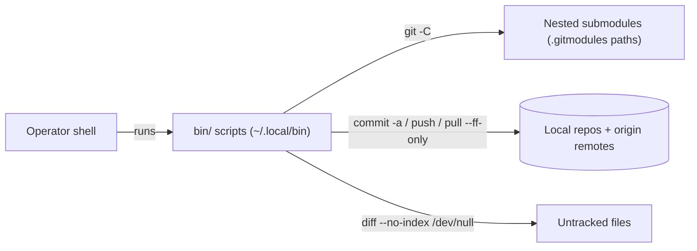

# Threat Model — misc-git-utils
<!-- 〚📁:17e3cfbf-1c58-5330-aab3-d321674f463f〛 Threat Model :: Trust boundaries, vulnerability register, residual risk. -->

## Overview

Four standalone Bash wrappers around `git` (`gcap`, `gp`, `submodule-diff`, `submodule-pull`), installed to the operator's `~/.local/bin`. There is no service, listener, network surface, or persistence: every operation is a local `git` invocation against whatever repository the operator runs it in, plus `git push`/`git pull` to configured remotes. The assets at risk are the operator's working trees and uncommitted work — `gcap` commits and pushes tracked changes wholesale, without review.

## Trust Boundaries

- operator shell → script (argv: commit message, optional repo root)
- script → local git repos, including every path listed in `.gitmodules`
- script → configured git remotes (`origin` for push/pull)

## Attack Surface

## Vulnerability Register

| ID | Severity | STRIDE | Component | Status |
|----|----------|--------|-----------|--------|
| T-001 | Medium | Information disclosure | `submodule-diff` streams the full contents of untracked, non-gitignored files (`git diff --no-index /dev/null <file>`) — an untracked secret file in any submodule is printed to stdout. | Partial — gitignored files are excluded via `ls-files --others --exclude-standard`; untracked secrets are not. |
| T-002 | Low | Tampering / Elevation of privilege | `submodule-pull` and `submodule-diff` trust `.gitmodules` paths verbatim and `git -C` into each; a hostile `.gitmodules` can aim them at any directory. | Open — accepted: sweeps run on operator-owned trees; operations are limited to git read/pull. |
| T-003 | Low | Tampering | `submodule-pull` fast-forwards submodules to their remote state; a compromised upstream flows straight into the worktree. | Open — accepted: `--ff-only` prevents history rewrites; remotes are operator-controlled. |
| T-004 | Low | Repudiation / Tampering | `gcap` runs `git commit -a` — commits every tracked modification without review, then pushes `origin HEAD`. No confirmation, no dry-run. | Open — accepted by design: one-shot commit+push is the tool's purpose. |

## Mitigation Coverage

0 mitigated · 1 partial · 3 open — all accepted residual risk for a single-operator utility. No secrets handling, no privileged operations, no network egress beyond git remotes.

## Residual Risk

The scripts deliberately remove git's review checkpoints (staging, per-push confirmation). This is accepted: they run only in operator-initiated sweeps on machines the operator already controls. Revisit if the scripts ever gain cron/CI callers or non-interactive use.
